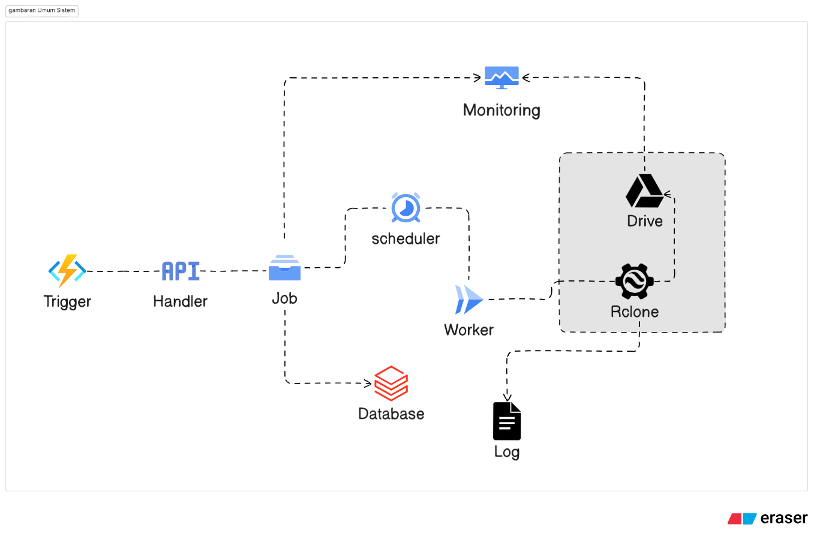

# G-Backup

***Web-based automated data backup management solution that bridges servers with Google Drive.***

---

## Key Features

- ***Script Runner Pipeline***: Execute backups through 3 phases (Pre-Script, Rclone Execution, Post-Script)
- ***Automated Scheduling***: CRON-based backup scheduling with Golang background worker
- ***Proactive Monitoring***: Visual dashboard for GDrive connection status, storage metrics, and execution logs
- ***Simple Restore***: Data recovery mechanism with automatic path inversion

---

## System Architecture


---

## Technology Stack

### Backend
- Golang
- Echo Framework
- GORM

### Frontend
- Vue.js 
- Vite
- Axios
- Pinia

### Infrastructure
- MariaDB/MySQL
- Rclone CLI
- Ubuntu/Linux

---

## Installation

### 1. Clone Repository
```bash
git clone https://github.com/username/G-Backup.git
cd g-backup
```

### 2. Set File Permissions
```bash
chmod +x install.sh
```

### 3. Execute Installation
```bash
./install.sh
```

---

## Starting the Application

### 1. Set File Permissions
```bash
chmod +x start.sh
```

### 2. Run the Application
```bash
./start.sh
```

---

## Application Access (Example)

```bash
✓ Application is up to date 
✓ System started successfully 

Access URL: 
➜ API Service: http://192.168.1.100:8080 (primary) 
➜ Web Interface: http://192.168.1.100:5173 (primary) 

Press Ctrl+C to stop
```
